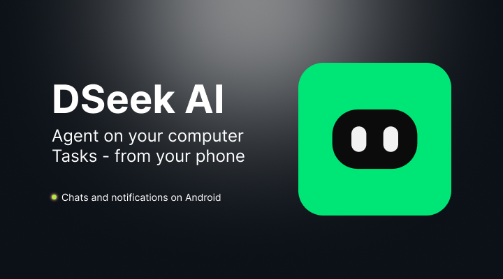
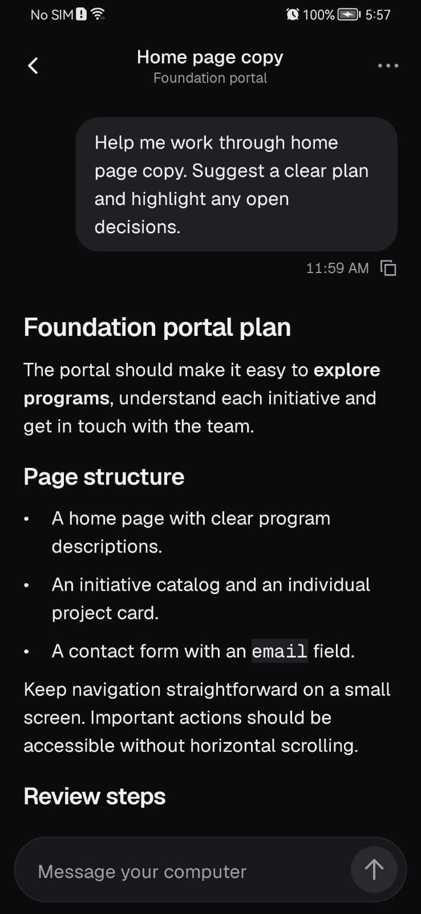
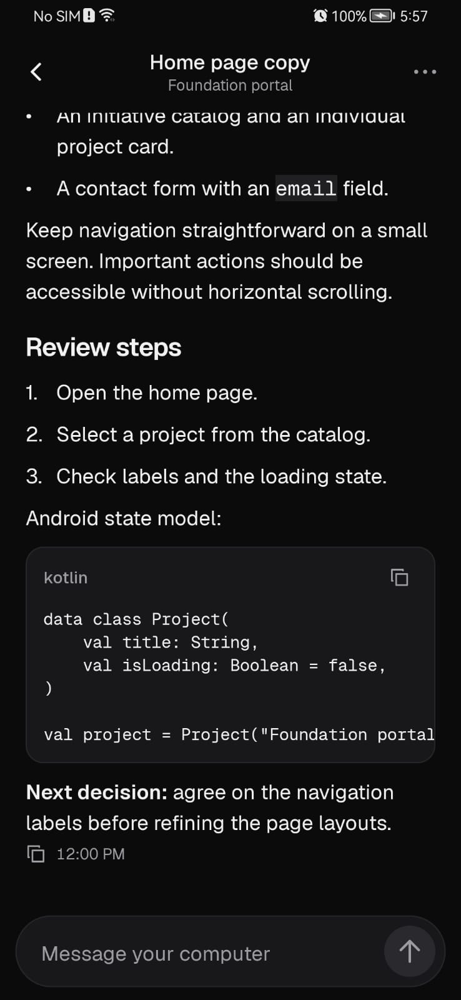
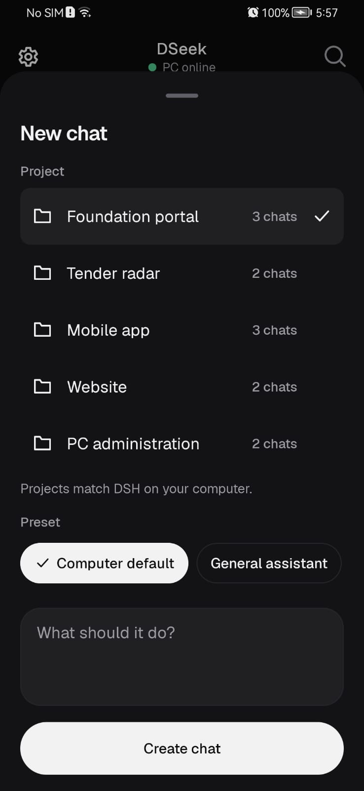
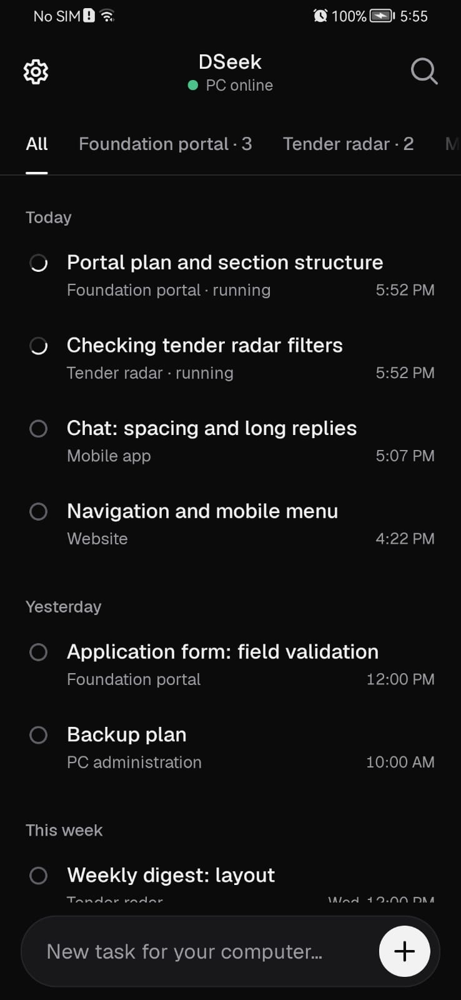
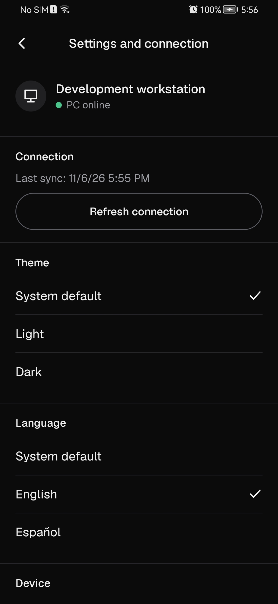
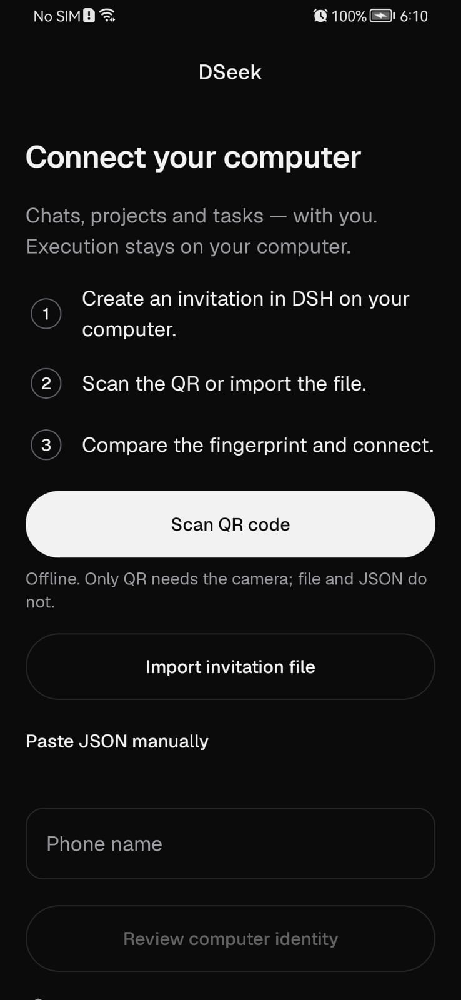
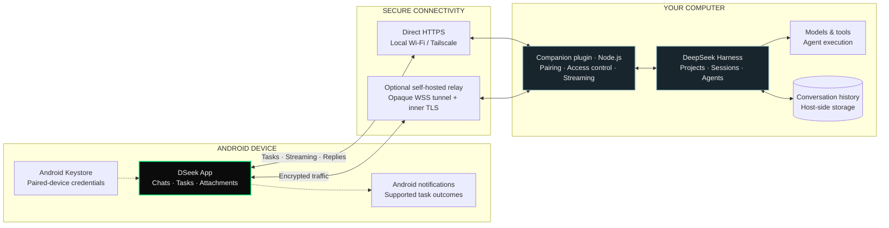

<!-- DSeek / Android companion for DeepSeek Harness -->

  

  <h1>DSeek</h1>

  
<strong>Your AI agent keeps working. You stay connected.</strong>

  

    A native Android companion for <a href="https://github.com/deepseek-ai/deepseek-harness">DeepSeek Harness</a>.
    Start tasks, follow progress, share context, and continue conversations with
    the agents running on your own computer — wherever you are.
  

  

    <a href="#experience">Experience</a> &nbsp;·&nbsp;
    <a href="#features">Features</a> &nbsp;·&nbsp;
    <a href="#how-it-works">How it works</a> &nbsp;·&nbsp;
    <a href="#getting-started">Getting started</a>
  

  

  
Android 8.0+ &nbsp;·&nbsp; Kotlin & Jetpack Compose &nbsp;·&nbsp; English / Español

  

## A desktop agent, without being tied to your desk

DSeek brings the conversations and controls of your **DeepSeek Harness (DSH)** workspace to a purpose-built Android interface. Your computer handles the models, tools, and execution; your phone is a convenient place to give the agent direction and see what happens next.

Whether you are reviewing a result away from your workstation, sending a photo for context, or responding to a question mid-task, DSeek keeps the workflow within reach. **It is a companion, not a separate AI provider or an on-device model.**

## Experience

  
  &nbsp;
  
  &nbsp;
  

  Conversations &nbsp;·&nbsp; Agent responses &nbsp;·&nbsp; New tasks

  
  &nbsp;
  
  &nbsp;
  

  Chat history &nbsp;·&nbsp; Settings &nbsp;·&nbsp; Secure pairing

These screenshots use synthetic demonstration content, not private chats or a live connected model. The image assets are kept under their existing `docs/images/0.8` path.

## Features

- **Your projects, one place.** Browse existing DSH conversations, search messages, filter by project, and start a chat in the workspace you choose.
- **Tasks from your phone.** Send a prompt, attach camera photos, images, or files, and keep the agent running on your computer even after you close the app.
- **Progress as it happens.** Follow streamed replies, formatted Markdown, code blocks, tables, and agent activity without switching back to the desktop.
- **Stay in control.** Queue another message, use *Steer* to guide the next agent step, answer an agent question, or request a run to stop.
- **Thoughtful conversation tools.** Rename chats, select an available model, preserve per-chat drafts, copy responses, and view or download supported attachments.
- **Useful notifications.** Receive Android alerts for supported phone-started tasks when a response is ready, a task fails, or the agent needs an answer.
- **Made for Android.** A Kotlin + Jetpack Compose interface with light/dark themes, scalable text, and English/Spanish language options.

Some actions depend on capabilities exposed by the paired host. Notifications are best-effort, not guaranteed background push; action approvals and full desktop administration remain on the computer.

## How it works

DSeek is a **native Android client**, not an AI runtime. It connects securely to the companion plugin on your computer, where DeepSeek Harness manages the agents, models, and conversation history.

**The computer does the work.** Your agent keeps running even when DSeek is closed. Models, provider credentials, subscriptions, and canonical conversations remain on the computer; the phone sends tasks and displays updates.

**Two connection options.** Connect directly over your local network or Tailscale, or use an optional **self-hosted relay** that forwards encrypted traffic without terminating the inner TLS session. This project does not provide a public relay service.

**Designed around explicit trust.** Short-lived pairing invitations authenticate a device against the host certificate. Android protects the device credentials with Keystore-backed storage. Read and execute rights can be granted separately; revoke a lost device from the host. Notifications depend on supported host capabilities and Android delivery conditions.

See [architecture](docs/ARCHITECTURE.md), [security model](docs/SECURITY.md), and [relay overview](docs/RELAY_OVERVIEW.md) for the implementation details and limitations.

## Getting started

| | Requirement |
| :-- | :-- |
| **Phone** | Android 8.0 (API 26) or later |
| **Computer** | Windows with a supported DeepSeek Harness installation |
| **Host** | Node.js 24.x, OpenSSL 3, companion plugin |
| **Connection** | Local Wi-Fi, Tailscale, or an operator-managed relay |
| **Build tools** | JDK 21 recommended, Android SDK 36 and build-tools 36.0.0 |

### Connect to your host

1. Read the [installation and pairing guide](docs/SETUP.md) and verify host compatibility.
2. Build or obtain a **matching** signed Android APK and host plugin package. Verify their provenance and SHA-256 checksums.
3. Install and activate the companion plugin on your Windows computer with explicit approval.
4. Install DSeek on your Android device, then pair it with the short-lived QR invitation and verify the host identity.
5. Open your projects and continue working with your desktop agents.

**Release availability:** This fork does not currently publish downloadable GitHub Releases. Do not assume that upstream APKs are releases of this fork or mix different app/host versions. See [build instructions](docs/BUILD.md) and the [0.9.2 release record](docs/RELEASE_0.9.2.md) for verified artifacts and compatibility notes.

### Build from source

From the repository root, use the documented toolchains:

~~~sh
# Android (Linux)
cd android
./gradlew :app:assembleDebug :app:testDebugUnitTest :app:lintDebug
~~~

~~~sh
# Companion plugin (Node.js 24.x)
cd host
npm ci
npm run check
~~~

For an isolated **Linux + Nix / Devenv demo** on a USB-connected phone, the repository also includes a reproducible development environment:

~~~sh
devenv shell
dseek-build
~~~

This demo uses synthetic data and **does not execute real agent tasks**. See the [demo guide](docs/DEMO.md) for device connection and setup. For production packaging, signing, and installation, follow the [build guide](docs/BUILD.md) and [Android release guide](docs/ANDROID_RELEASE.md).

## Built with

- **Android:** Kotlin, Jetpack Compose, Material 3, Coroutines, OkHttp, Android Keystore.
- **Desktop companion:** Node.js 24, TypeScript, authenticated HTTPS, event streaming.
- **Connectivity:** direct LAN, Tailscale, or optional self-hosted encrypted relay.
- **Developer workflow:** Gradle, automated tests, GitHub Actions, and Nix / Devenv.

The Android source currently identifies itself as **0.9.2** (`versionCode 19`), with a matching host plugin documented in the [0.9.2 release notes](docs/RELEASE_0.9.2.md). The app and host must be updated together; operators of a self-hosted relay should review the corresponding relay update instructions.

## Project notes

- DSeek requires a running computer and DSH instance; **there is no offline agent execution** on the phone.
- It exposes a deliberately focused mobile workflow, not every feature of the desktop application.
- Offline content may be a limited, read-only cached snapshot; network failures do not imply a queued command was never executed.
- Secure pairing does not make broad agent/tool permissions safe. Grant execute access only to trusted devices.

## Documentation

[Setup & pairing](docs/SETUP.md) ·
[Architecture](docs/ARCHITECTURE.md) ·
[Security](docs/SECURITY.md) ·
[Protocol](docs/PROTOCOL.md) ·
[Build](docs/BUILD.md) ·
[UI languages](docs/I18N.md) ·
[Relay deployment](docs/RELAY_DEPLOYMENT.md) ·
[Contributing](CONTRIBUTING.md)
